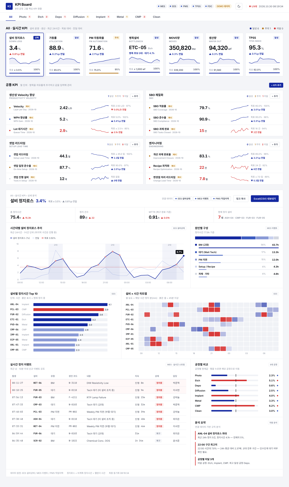
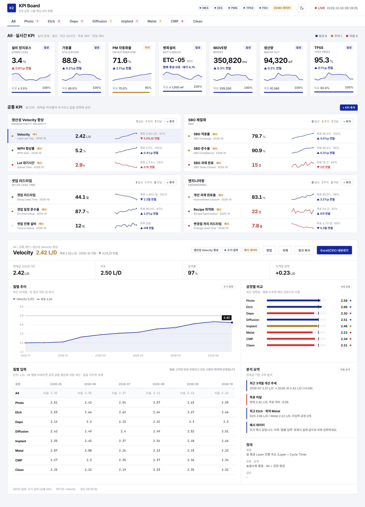
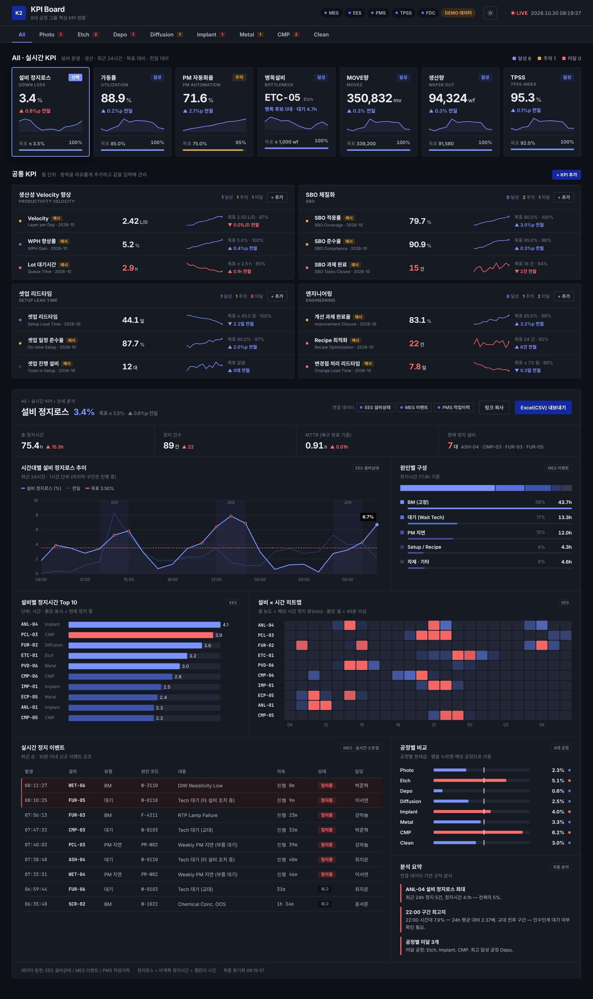
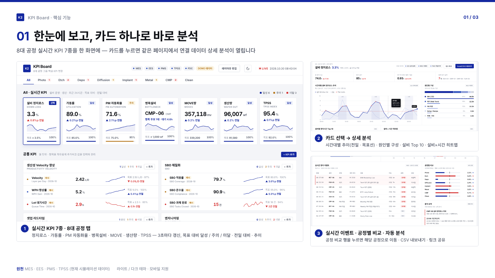
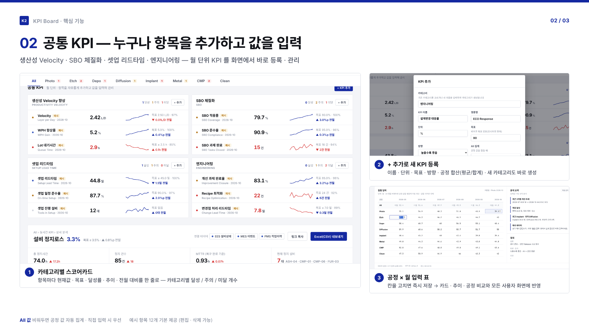
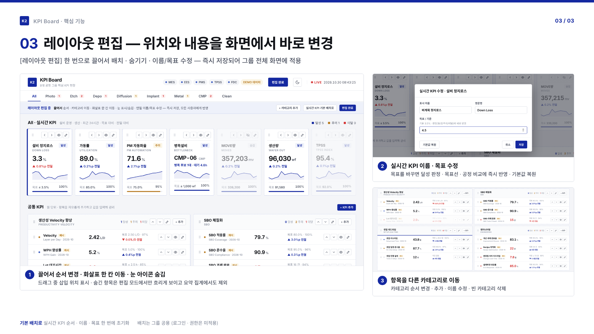
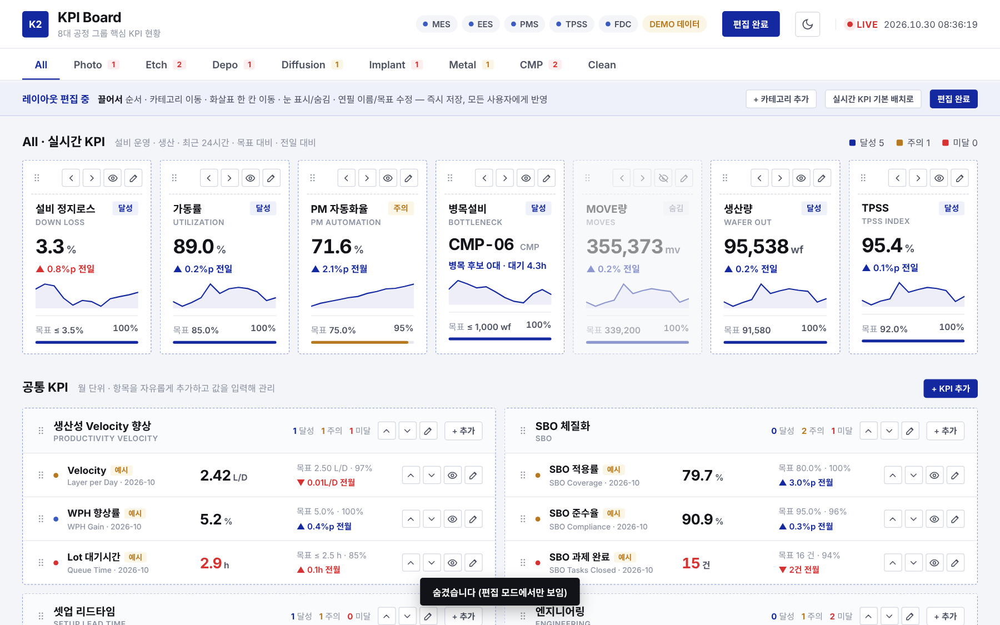

# K2 KPI Board

8대 공정(Photo · Etch · Depo · Diffusion · Implant · Metal · CMP · Clean) 그룹 공통 KPI 대시보드.

- **실시간 KPI 7종**: 설비 운영 · 생산 지표를 3초마다 갱신
- **공통 KPI**: 생산성 Velocity 향상 · SBO 체질화 · 셋업 리드타임 · 엔지니어링 — 화면에서 항목을 자유롭게 추가하고 월별 값을 입력
- 카드/항목을 선택하면 같은 페이지 아래에 상세 분석(추이 · 구성 · 설비 랭킹 · 히트맵 · 이벤트 · 공정 비교 · 자동 분석)
- 라이트 / 다크 테마 (우측 상단 버튼, 브라우저에 기억)



| 공통 KPI | 다크 테마 |
|---|---|
|  |  |

## 데모

- 전체 기능 데모 영상 (약 2분): [docs/demo/K2_KPI_Board_demo.mp4](docs/demo/K2_KPI_Board_demo.mp4)
- 핵심 기능 요약 (3페이지)

| 01 한눈에 보기 · 상세 분석 | 02 공통 KPI 추가 · 입력 | 03 레이아웃 편집 |
|---|---|---|
|  |  |  |

## 레이아웃 편집

우측 상단 `레이아웃 편집`을 누르면 편집 모드가 된다. 변경은 즉시 서버에 저장되고 접속 중인 모든 화면에 반영된다(그룹 공용 배치).

| 대상 | 할 수 있는 것 |
|------|---------------|
| 실시간 KPI 카드 | 끌어서 / ◀ ▶ 로 순서 변경, 눈 아이콘으로 숨김/표시, 연필로 표시 이름 · 영문명 · 목표(기준) 변경, `기본값 복원` |
| 공통 KPI 항목 | 끌어서 순서 변경 및 **다른 카테고리로 이동**, ▲ ▼ (카테고리 끝에서는 이웃 카테고리로 넘어감), 숨김/표시, 연필로 정의 수정 |
| 카테고리 | 머리글을 끌어서 / ▲ ▼ 로 순서 변경, 이름 · 영문명 수정, `+ 카테고리 추가`, 빈 카테고리 삭제 |

- 목표 변경은 달성/주의/미달 판정, 추이 목표선, 공정 비교에 바로 반영된다 (MOVE · 생산량은 공정별 일 계획값을 쓰므로 이름만 변경)
- 숨긴 항목은 편집 모드에서만 흐리게 보이고, 상단 요약 · 공정 탭 미달 개수 집계에서도 빠진다
- `실시간 KPI 기본 배치로`: 실시간 KPI 의 순서 · 숨김 · 이름 · 목표를 기본값으로 되돌림 (공통 KPI 는 유지)
- 저장 위치: `data/layout.json` (`KPI_LAYOUT_FILE`), 공통 KPI 배치는 `data/custom_kpis.json`



## 실시간 KPI

| KPI | 정의 | 목표 | 원천 |
|-----|------|------|------|
| 설비 정지로스 | 비계획 정지시간 ÷ 캘린더 시간 | ≤ 3.5% | EES · MES · PMS |
| 가동률 | Run 시간 ÷ 캘린더 시간 | 85% | EES · MES |
| PM 자동화율 | 자동 수행 PM 항목 ÷ 전체 (주간) | 75% | PMS |
| 병목설비 | 현재 대기 WIP 최대 설비 | ≤ 1,000매 | MES WIP · EES |
| MOVE량 | 최근 24h Track-out Step 수 | 공정별 일 목표 | MES |
| 생산량 | 최근 24h Out 웨이퍼 | 공정별 일 목표 | MES |
| TPSS | TPSS 설비별 지수 평균 | 92 | TPSS |

판정: 목표 충족 = 달성, 목표의 95% 이상 = 주의, 그 외 = 미달.

## 공통 KPI (사용자 정의)

기본 카테고리와 예시 항목(예시 값 포함, `예시` 표시):

| 카테고리 | 항목 |
|----------|------|
| 생산성 Velocity 향상 | Velocity (L/D), WPH 향상률, Lot 대기시간 |
| SBO 체질화 | SBO 적용률, SBO 준수율, SBO 과제 완료 |
| 셋업 리드타임 | 셋업 리드타임, 셋업 일정 준수율, 셋업 진행 설비 |
| 엔지니어링 | 개선 과제 완료율, Recipe 최적화, 변경점 처리 리드타임 |

- `+ KPI 추가` / 카테고리별 `+ 추가`: 이름 · 단위 · 목표(비우면 목표 없음) · 방향 · All 집계(평균/합계) 지정. 새 카테고리 이름을 입력하면 카테고리가 생성됨
- 상세 화면의 `월별 입력` 표에서 셀을 고치면 즉시 저장되고 접속 중인 모든 화면에 반영
- All 행을 비워두면 공정 값을 평균/합계해 자동 계산, 직접 입력하면 그 값이 우선
- 저장 위치: `data/custom_kpis.json` (`KPI_DATA_FILE`로 변경). 파일이 없으면 예시 데이터로 생성되므로, 실사용 전 예시 항목을 편집/삭제하거나 파일을 지우고 새로 등록

## 실행

```bash
pip install -r requirements.txt
python app.py            # http://localhost:8000
pytest -q                # API 테스트
```

- 외부 CDN 없이 동작 (폰트 로컬 포함, 차트는 SVG 직접 렌더링) — 사내망 배포 가능
- 공유 링크: `/#process=photo&kpi=downloss` 형태로 공정 · KPI 상태가 URL에 저장됨
- 상세 화면의 `Excel(CSV) 내보내기`로 추이 · 랭킹 · 이벤트 표를 내려받을 수 있음

## 구조

```
app.py            FastAPI: 페이지, REST API, WebSocket(구독형 실시간 push)
data_source.py    실시간 KPI — KPIProvider 인터페이스 + SimulatedProvider(데모 데이터)
custom_kpis.py    공통 KPI — 정의 · 월별 값 · 카테고리/배치 저장(JSON) · 카드/상세 계산
layout.py         화면 배치 — 실시간 KPI 순서 · 숨김 · 이름/목표 변경 저장(JSON)
templates/        index.html
static/           css / js / fonts
tests/            API · 데이터 일관성 테스트
mockup/           최초 디자인 시안
```

### API

| Method | Path | 설명 |
|--------|------|------|
| GET | `/api/processes` | 공정 목록 + 공정별 미달/주의 KPI 수 |
| GET | `/api/kpis?process=all` | KPI 카드 8종 |
| GET | `/api/kpis/{kpi}?process=all` | KPI 상세 (실시간 · 공통 KPI 공용, `kind`로 구분) |
| GET | `/api/custom-kpis?process=all` | 공통 KPI 카테고리 + 카드 |
| POST | `/api/custom-kpis` | 공통 KPI 추가 |
| PUT | `/api/custom-kpis/{kpi}` | 정의 수정 |
| DELETE | `/api/custom-kpis/{kpi}` | 삭제 |
| PUT | `/api/custom-kpis/{kpi}/values` | `{"process":"photo","period":"2026-10","value":2.4}` (value null = 삭제) |
| GET | `/api/layout` | 실시간 KPI 순서 · 숨김 · 이름/목표 변경값 · 기본값 |
| PUT | `/api/layout/core` | `{"order":[...], "hidden":[...]}` |
| PUT | `/api/layout/core/{kpi}` | `{"name":..., "en":..., "target":...}` 또는 `{"reset":true}` |
| POST | `/api/layout/reset` | 실시간 KPI 배치 · 내용 기본값으로 |
| PUT | `/api/custom-layout` | `{"categories":[{"id":"velocity","kpis":[...]}, ...]}` 카테고리 순서 · 소속 · 항목 순서 일괄 저장 |
| POST / PUT / DELETE | `/api/custom-categories[/{id}]` | 카테고리 추가 · 이름 변경 · (빈 카테고리) 삭제 |
| GET | `/api/sources` | 연결 데이터 소스 상태 |
| WS | `/ws` | `{"type":"subscribe","process":"photo","kpi":"downloss"}` 구독 → `kpi_update` 주기 push |

`process`: `all`, `photo`, `etch`, `depo`, `diff`, `imp`, `metal`, `cmp`, `clean`
실시간 `kpi`: `downloss`, `util`, `pm_auto`, `bottleneck`, `move`, `output`, `tpss` / 공통 KPI는 생성 시 발급된 id

## 실데이터 연동

현재는 **시뮬레이션 데이터**(헤더에 `DEMO 데이터` 표시)로 동작한다. 정지 이벤트를 원천으로
정지로스 → 가동률 → MOVE → 생산량 · 대기 WIP · TPSS 를 파생시켜 화면의 숫자가 서로 맞도록 만들었다.

실데이터 연동 시:
1. `data_source.py`의 `KPIProvider`를 구현한 클래스 작성 (`processes` / `cards` / `detail` / `tick` / `sources`)
   - 반환 JSON 구조는 `SimulatedProvider`와 동일하게 맞추면 프론트엔드 수정 불필요
   - `tick()`에서 MES / EES / PMS / TPSS 폴링 또는 스트림 반영
2. `get_provider()`에 등록 후 `KPI_PROVIDER=<이름>` 환경 변수로 선택
3. 갱신 주기: `KPI_TICK_SEC` (기본 3초)

인증이 없으므로 공통 KPI · 레이아웃 편집은 접속 가능한 누구나 할 수 있다. 사내망 외부 노출 시 인증 추가 필요.

TPSS 지표 정의와 KPI 목표값(`KPIS` 목록)은 실제 기준에 맞게 조정 필요.
